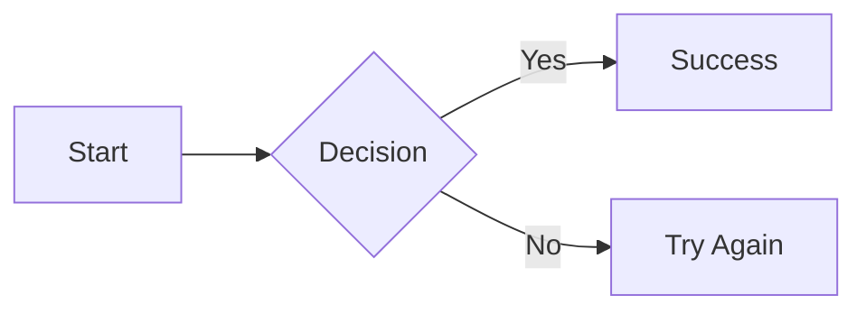

[Mermaid](https://mermaid.js.org/) fences remain ordinary code blocks until a diagram extension is supplied. This keeps the main package independent of large diagram runtimes.

## Pele

[Pele](https://pele.run/) is the recommended renderer for new projects. It loads diagram types on demand and uses your Shiki theme when the code extension is configured.

```sh
pnpm add @stream-markdown/pele
```

```vue
<script setup lang="ts">
import { pele } from '@stream-markdown/pele'
import { Markdown } from 'vue-stream-markdown'

const extensions = { pele: pele() }
</script>

<template>
  <Markdown :content="content" :extensions="extensions" />
</template>
```

## Standard Mermaid

Standard Mermaid supports all diagram types provided by the installed Mermaid version:

```sh
pnpm add @stream-markdown/mermaid
```

```vue
<script setup lang="ts">
import { mermaid } from '@stream-markdown/mermaid'
import { Markdown } from 'vue-stream-markdown'

const extensions = {
  mermaid: mermaid({
    theme: ['neutral', 'dark'],
  }),
}
</script>

<template>
  <Markdown :content="content" :extensions="extensions" />
</template>
```

## Beautiful Mermaid

[Beautiful Mermaid](https://github.com/lukilabs/beautiful-mermaid) provides a smaller renderer with polished built-in themes for its supported diagram types:

```sh
pnpm add @stream-markdown/beautiful-mermaid
```

```ts
import { beautifulMermaid } from '@stream-markdown/beautiful-mermaid'

const extensions = {
  beautifulMermaid: beautifulMermaid({
    theme: ['github-light', 'github-dark'],
    config: { padding: 12 },
  }),
}
```

## Combine renderers

When you configure more than one extension, the first renderer that supports the diagram type is used, in this order: Beautiful Mermaid, Pele, then standard Mermaid. Unsupported diagrams stay visible as source.

## Basic syntax

Create diagrams using a fenced code block with the `mermaid` language:

````markdown

````

::stream-markdown{example="feature-mermaid.basicFlowchart"}
::

## Diagram examples

### Flowchart

::stream-markdown{example="feature-mermaid.flowchart"}
::

### Sequence diagram

::stream-markdown{example="feature-mermaid.sequenceDiagram"}
::

### State diagram

::stream-markdown{example="feature-mermaid.stateDiagram"}
::

### Class diagram

::stream-markdown{example="feature-mermaid.classDiagram"}
::

### Entity relationship diagram

::stream-markdown{example="feature-mermaid.erDiagram"}
::

### Pie and Gantt charts

Pele renders both charts. Use the renderer button to compare with other engines.

::stream-markdown{example="feature-mermaid.pieChart"}
::

::stream-markdown{example="feature-mermaid.ganttChart"}
::

## Provider configuration

Configuration is passed directly to the extension factory:

```ts
import type { MermaidExtensionOptions } from '@stream-markdown/mermaid'
import { mermaid } from '@stream-markdown/mermaid'

const options: MermaidExtensionOptions = {
  theme: ['base', 'dark'],
  config: {
    securityLevel: 'strict',
    flowchart: {
      nodeSpacing: 50,
      rankSpacing: 50,
      curve: 'basis',
    },
    sequence: {
      actorMargin: 50,
    },
  },
}

const mermaidExtension = mermaid(options)
```

See [Extensions](/config/extensions) for CDN loading, error components, and all factory options.

## Interactive controls

Rendered diagrams use the normal code-block preview/source switch and support fullscreen, SVG/PNG download, and zoom controls. See [Controls](/config/controls) for customization.

Diagrams automatically fit the preview area, including fixed-height and fullscreen previews. Resizing the container updates the fit until you manually zoom or pan. Use the **Reset view** button in the zoom toolbar to return to the complete diagram; **100%** restores the original scale and centers the view.

## Streaming behavior

During streaming, incomplete Mermaid fences remain readable and preview rendering is throttled. A diagram becomes previewable only when at least one configured extension reports that it supports the current source.

## Troubleshooting

- Confirm the fence language is `mermaid`.
- Verify the corresponding extension instance is included in `extensions`.
- Installing `@stream-markdown/mermaid` also installs its Mermaid runtime.
- Test syntax in the [Mermaid Live Editor](https://mermaid.live/).
- Add standard Mermaid as a fallback for types the other configured renderers do not support.

## Resources

- [Pele compatibility](https://pele.run/compatibility)
- [Mermaid documentation](https://mermaid.js.org/intro/)
- [Beautiful Mermaid documentation](https://github.com/lukilabs/beautiful-mermaid)
